# Side to Side - Game Website, API and Admin Panel

The Laravel back-end for the mobile game **Side to Side**: a public website, a REST API for the game client, an in-game store, and Filament admin and player dashboards.

## Overview

Built during my internship (August to December 2024). The application has three jobs:

1. **Public website.** Its pages (home, blog, privacy policy, terms) are managed as posts and content blocks from the admin panel.
2. **Game back-end.** A REST API the mobile game uses for accounts, scores, coins, retries, and buying and equipping skins and backgrounds.
3. **Operations.** A Filament admin panel to manage content, users, game items and advertising, with revenue and growth charts. A separate player panel shows each user their own progress.

## Features

### Website and accounts
- Home, blog, privacy-policy and terms pages rendered from database posts grouped by category and section, with reusable content blocks
- Sign-up with e-mail verification, login and logout, forgot / reset password
- Social login with **Google** and **Apple** (Laravel Socialite)
- E-mail addresses can be stored encrypted and hashed (`emails:manage` Artisan command)
- The browser's timezone is stored per user (`SetUserTimezone` middleware) so dates display in local time
- User and guest activity tracking (`TrackUserActivity` middleware, last-visit and current-visit endpoints)

### Game API (`routes/api.php`, Laravel Sanctum)
- `POST /api/register`, `/api/login`, `/api/logout`, `/api/google-login`
- `POST /api/forgot-password`, `/api/reset-password`, `/api/change-password`, e-mail verification
- `GET /api/user-profile/{userId}` - score, coins, retries, unlocked and selected items
- `POST /api/update-score-coins`, `/api/reset-score-retry`, `/api/update-profile-image`
- `GET /api/skins-and-backgrounds`, `POST /api/purchase-item`, `POST /api/select-item`, `GET /api/get-item-by-id` - in-game store: buy skins and backgrounds with coins and equip them

### Admin panel (Filament, `/admin`)
- Resources for **Posts** (with categories, sections, scheduled publishing and a manual override), **Categories**, **Team members**, **Users**, **Skins**, **Backgrounds**, **Trophies** and **Ads**
- **Advertising**: custom image ads or Google ad code, per platform, with start and end dates, CPC and CPM rates, click and view tracking, revenue and paid status, and CSV reports per client or for all clients
- Dashboard charts: monthly registered users, users vs guests, downloads by platform, monthly revenue and bills
- Roles and permissions with `spatie/laravel-permission`

### Player panel (Filament, `/user`)
- Widgets for total score, coins, retry count, selected skin and background, and unlocked skins, backgrounds and trophies

### Scheduled jobs (`app/Console/Kernel.php`)
- `reset:user-registration-counts` - daily reset of registration counters
- `track:inactive-users` - updates last-visit data for inactive users
- `ads:update-status` - turns ads on or off from their date range unless manually overridden
- `posts:update-status` - publishes or unpublishes posts on schedule

## Tech Stack

- **Backend:** PHP 8.2+, Laravel 10, Laravel Sanctum, Laravel Socialite
- **Admin UI:** Filament 3, Livewire 3
- **Auth and permissions:** spatie/laravel-permission
- **Frontend:** Blade, Vite
- **Database:** MySQL (Doctrine DBAL for column changes in migrations)

## Project Structure

```
app/
  Console/Commands/          scheduled and maintenance commands
  Filament/
    Resources/               Ads, Posts, Categories, Skins, Backgrounds, Trophies, Users, Team members
    Widgets/                 admin charts
    User/Widgets/            player dashboard widgets
  Http/
    Controllers/             website, auth, game API (GameInfo, Skins, Ads, Posts)
    Middleware/              TrackUserActivity, SetUserTimezone, EnsureEmailIsVerified
  Models/                    User, GameInfo, Skin, Background, Trophy, Ad, AdStatistic, Post, ...
  Providers/Filament/        AdminPanelProvider, UserPanelProvider
database/migrations/         full schema history
resources/views/             website pages, auth, e-mails, Filament views
routes/web.php, routes/api.php
```

## Getting Started

### Prerequisites
- PHP 8.2+ with the `intl` extension, Composer, Node.js and npm
- MySQL
- Optional: Google and Apple OAuth credentials and an SMTP account

### Installation

```bash
git clone https://github.com/Alex03issa/InternshipProject.git
cd InternshipProject
composer install
npm install && npm run build
cp .env.example .env
php artisan key:generate
php artisan storage:link
```

### Configuration

Set the database, mail and OAuth values in `.env`:

```dotenv
DB_CONNECTION=mysql
DB_DATABASE=side_to_side
DB_USERNAME=your_db_user
DB_PASSWORD=your_db_password

MAIL_MAILER=smtp
MAIL_HOST=...

GOOGLE_CLIENT_ID=...
GOOGLE_CLIENT_SECRET=...
GOOGLE_REDIRECT_URI="${APP_URL}/auth/google/callback"
```

### Run

```bash
php artisan migrate
php artisan make:filament-user      # create an admin login
php artisan serve
php artisan schedule:work           # run scheduled jobs locally
```

- Website: http://localhost:8000
- Admin panel: http://localhost:8000/admin
- Player panel: http://localhost:8000/user

## Screenshots

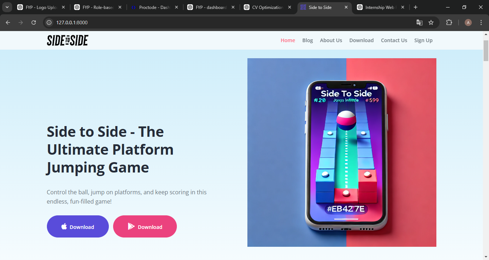
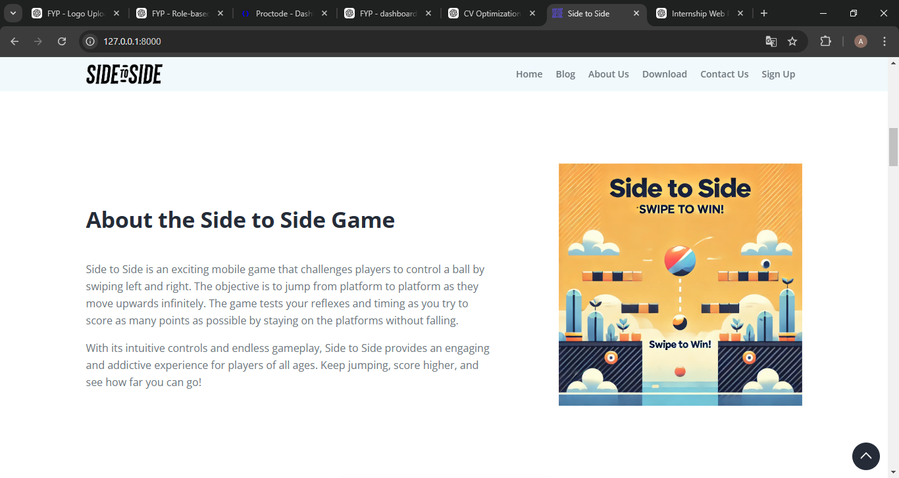
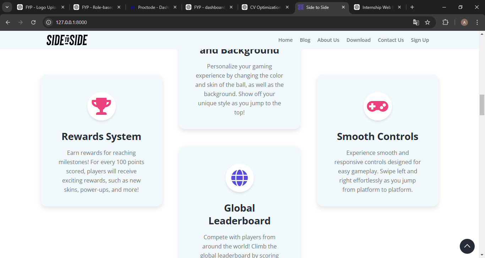
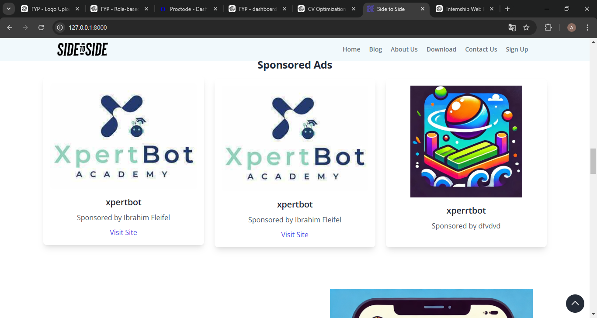
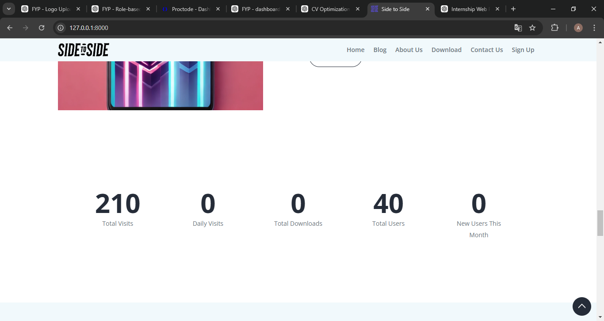
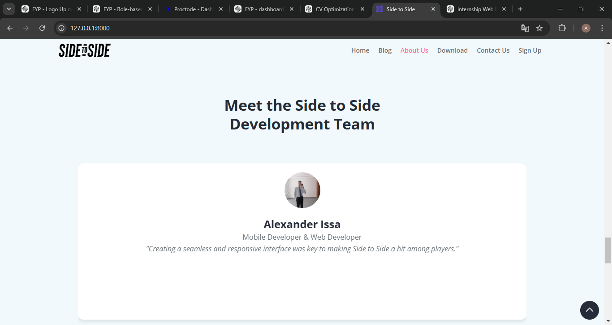
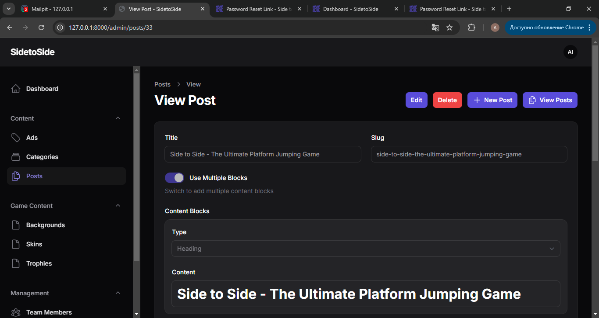
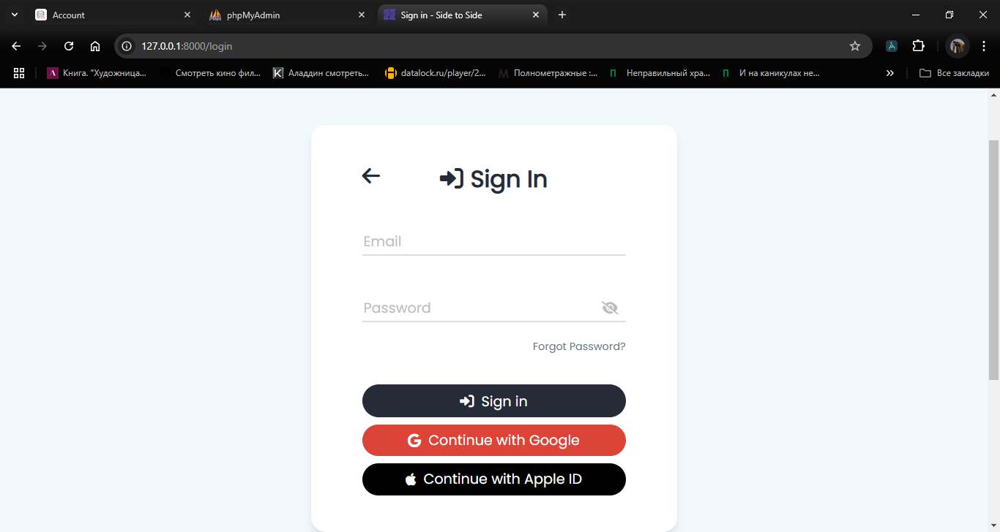
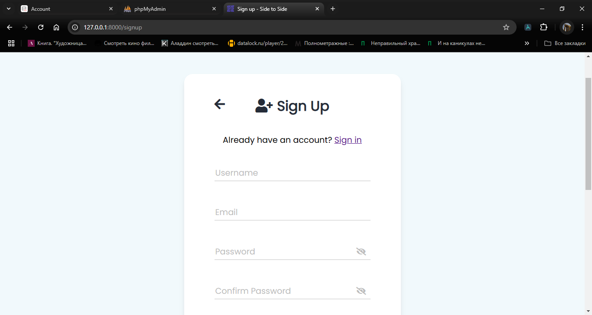
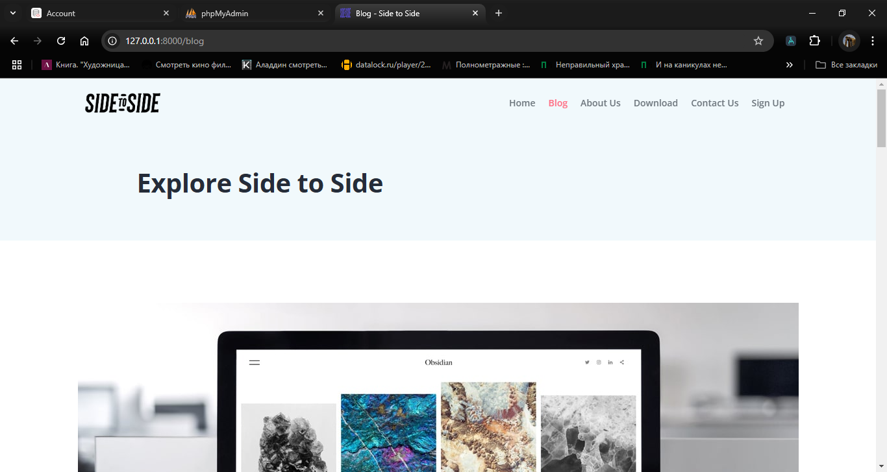
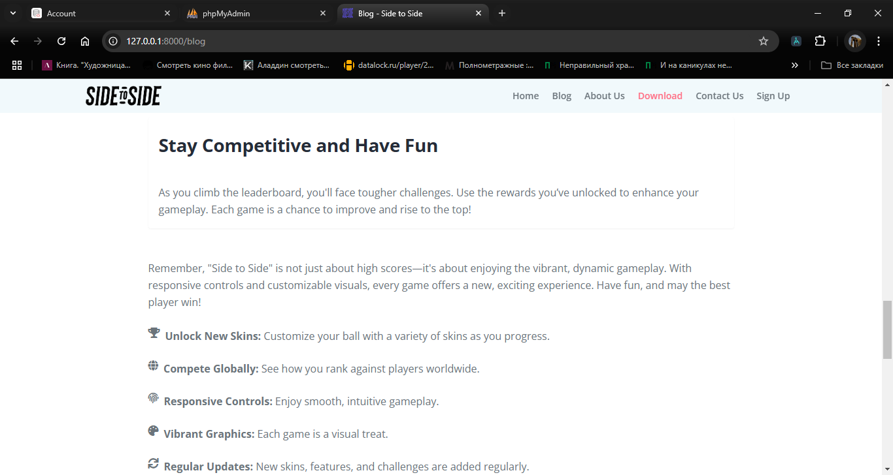

## Author

Alexander Issa - [@Alex03issa](https://github.com/Alex03issa)
